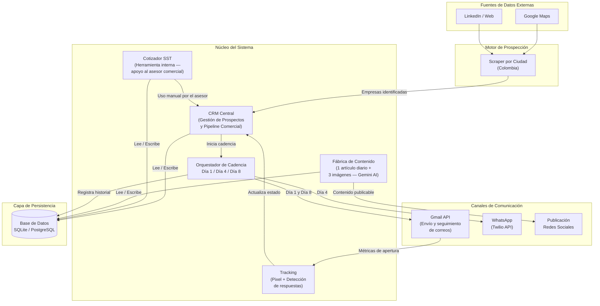
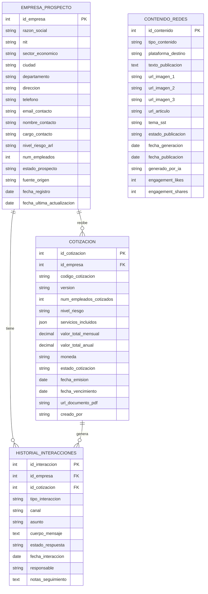
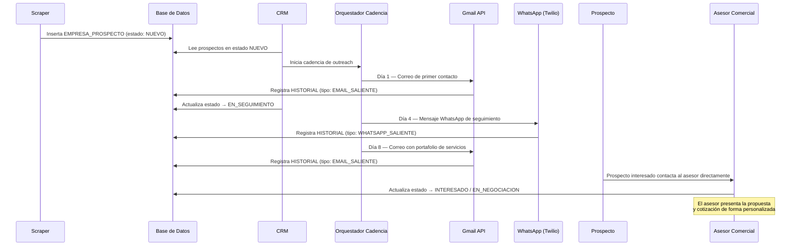

# Arquitectura y Diseño del Sistema
## Ecosistema Inteligente de Prospección Comercial, CRM y Automatización de Cotizaciones para Servicios SST

**Cliente:** Medina SST Empresarial SAS  
**Versión:** 1.1.0  
**Fecha:** 2026-06-22  
**Clasificación:** Documentación Técnica Interna

---

## 1. Introducción

Medina SST Empresarial SAS es una empresa colombiana especializada en la prestación de servicios de Seguridad y Salud en el Trabajo (SST), con capacidad de atender empresas en múltiples ciudades del territorio nacional. El crecimiento del mercado regulado por la **Resolución 0312 de 2019** del Ministerio del Trabajo exige una operación comercial ágil, trazable y escalable.

El presente sistema constituye un **ecosistema de software integrado** diseñado para automatizar el ciclo completo de prospección, relacionamiento y cotización de clientes empresariales. Sus pilares funcionales son:

- **Motor de Prospección:** scraping automatizado de empresas objetivo en Google Maps y LinkedIn, segmentado por ciudad y sector económico en Colombia.
- **CRM Central:** gestión del ciclo de vida del prospecto desde el primer contacto hasta el cierre comercial.
- **Cotizador SST:** generación de propuestas económicas parametrizadas según los estándares de la Resolución 0312.
- **Secuencia de Outreach Omnicanal:** cadencia automatizada Día 1 → Día 4 → Día 8 vía Email y WhatsApp, con el objetivo de generar interés y que el prospecto contacte directamente a la empresa.
- **Fábrica de Contenido:** generación diaria automatizada de contenido para redes sociales (1 artículo + 3 imágenes con IA).

---

## 2. Diagrama de Componentes

El siguiente diagrama representa la arquitectura de alto nivel del sistema, mostrando los módulos principales y sus dependencias de comunicación.



---

## 3. Diagrama Entidad-Relación (DER)

El siguiente DER describe el modelo de datos relacional que sostiene el ecosistema. Se representan las cuatro entidades centrales con sus atributos, claves primarias (PK) y claves foráneas (FK).



---

## 4. Flujo de Prospección End-to-End



---

## 5. Cadencia de Outreach Omnicanal

La secuencia de contacto automatizado sigue una cadencia de 3 puntos de contacto:

| Día | Canal | Contenido | Condición |
|---|---|---|---|
| **1** | Email (Gmail) | Presentación de Medina SST + invitación a agendar | Siempre al registrar el prospecto |
| **4** | WhatsApp (Twilio) | Seguimiento breve + CTA para confirmar interés | Solo si la empresa tiene teléfono registrado |
| **8** | Email (Gmail) | Portafolio completo de servicios + botón WhatsApp | ≥4 días desde Día 4, o ≥7 días desde Día 1 si no hubo Día 4 |

Si la empresa no tiene teléfono, el Día 4 se omite y el Día 8 se calcula desde el Día 1.  
Toda la cadencia queda trazada en `HISTORIAL_INTERACCIONES` con prefijos `[SEQ:DIA_1]`, `[SEQ:DIA_4]`, `[SEQ:DIA_8]`.

> **Importante:** La cadencia automatizada tiene como único objetivo despertar el interés del prospecto. Una vez que el prospecto contacta al asesor comercial, la negociación y presentación de la propuesta económica se realizan de forma **personalizada y manual** por parte del asesor. El Cotizador SST del sistema es una herramienta de apoyo interno para que el asesor prepare las cifras, no un proceso automático.

---

## 6. Stack Tecnológico Implementado

| Capa | Tecnología | Estado |
|---|---|---|
| Frontend / CRM | Python + **Streamlit** | Implementado |
| Visualización | Plotly + Pandas | Implementado |
| Base de Datos | **SQLite** (local) / PostgreSQL (producción) | Implementado |
| ORM | SQLAlchemy 2.0 + Alembic | Implementado |
| Scraping | Playwright + BeautifulSoup + httpx | Implementado |
| IA / Contenido | **Gemini 2.0 Flash** (Google — gratuito) | Implementado |
| Generación de imágenes | Prompts automáticos (DALL-E 3 / Stable Diffusion — opcional) | Prompts listos, activación pendiente |
| Email | Gmail API (OAuth 2.0) | Implementado |
| WhatsApp | **Twilio API** | Implementado |
| Documentos | ReportLab + Pillow | Implementado |
| Plantillas HTML | Jinja2 | Implementado |
| Compliance | Habeas Data (Ley 1581/2012) | Implementado |
| Configuración | python-dotenv (.env) | Implementado |

---

## 7. Estructura de Módulos del Proyecto

```
SOFTWARE COMERCIAL/
├── app.py                          # Punto de entrada Streamlit
├── src/
│   ├── config.py                   # Configuración global (AppConfig singleton)
│   ├── data/
│   │   └── ciudades_colombia.py    # Referencia de ciudades + zonas de viáticos
│   ├── database/
│   │   ├── models.py               # Modelos ORM (4 entidades)
│   │   ├── connection.py           # Gestión de sesiones SQLAlchemy
│   │   └── init_db.py              # Creación de tablas + datos semilla
│   ├── domain/
│   │   ├── entities.py             # Dataclasses puras + enums de negocio
│   │   └── resolution_0312.py      # Lógica Res. 0312/2019 (60 estándares)
│   ├── frontend/
│   │   ├── pages/                  # Páginas Streamlit (dashboard, cotizador,
│   │   │   │                       #   scraper, campañas, contenido, analítica,
│   │   │   │                       #   compecer, servicios)
│   │   ├── components/             # Componentes reutilizables (métricas)
│   │   └── styles.py               # Estilos CSS personalizados
│   └── modules/
│       ├── cotizador/              # Calculadora + viáticos + exportador PDF
│       ├── email/                  # Gmail client + plantillas + rate limiter
│       ├── whatsapp/               # Twilio client + plantillas WhatsApp
│       ├── outreach/               # Orquestador de cadencia Día 1/4/8
│       ├── scraper/                # Engine + Google Maps + LinkedIn + pipeline
│       ├── contenido/              # Generador artículos (Gemini) + imágenes
│       ├── tracking/               # Pixel tracker + detección de respuestas
│       └── compliance/             # Habeas Data (Ley 1581/2012)
├── assets/                         # Logos (Medina SST, Compecer)
├── credentials/                    # Tokens OAuth Gmail (gitignored)
├── output/                         # Cotizaciones PDF + contenido generado
└── docs/
    └── arquitectura_y_diseno.md    # Este documento
```

---

*Documento actualizado el 2026-06-22. Para consultas contactar al equipo de desarrollo.*
