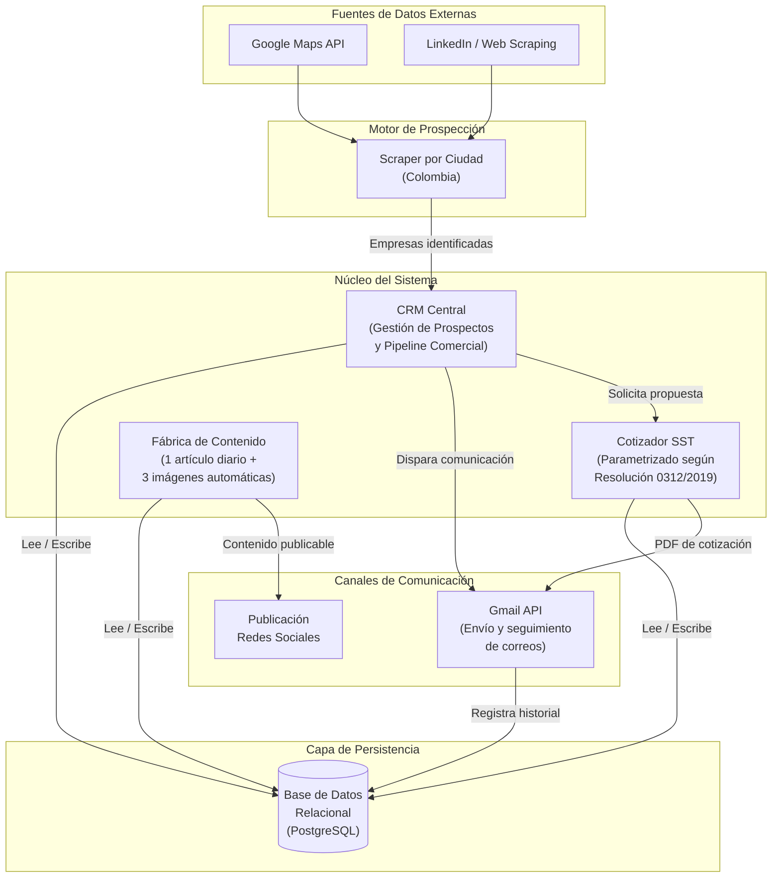
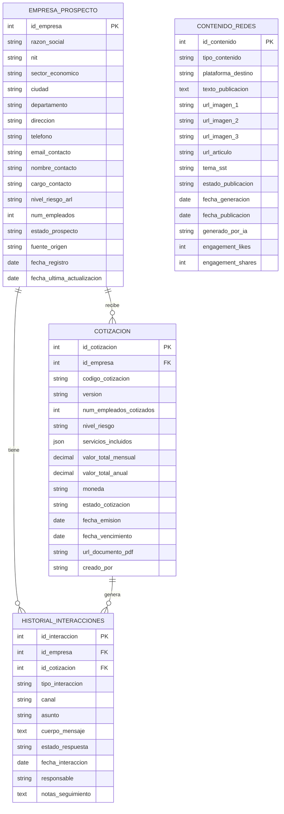
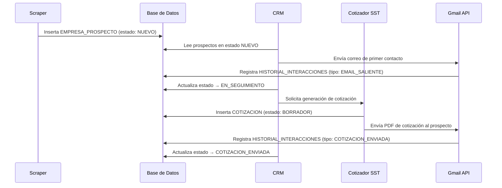

# Arquitectura y Diseño del Sistema
## Ecosistema Inteligente de Prospección Comercial, CRM y Automatización de Cotizaciones para Servicios SST

**Cliente:** Medina SST Empresarial SAS  
**Versión:** 1.0.0  
**Fecha:** 2026-06-01  
**Clasificación:** Documentación Técnica Interna

---

## 1. Introducción

Medina SST Empresarial SAS es una empresa colombiana especializada en la prestación de servicios de Seguridad y Salud en el Trabajo (SST), con capacidad de atender empresas en múltiples ciudades del territorio nacional. El crecimiento del mercado regulado por la **Resolución 0312 de 2019** del Ministerio del Trabajo exige una operación comercial ágil, trazable y escalable.

El presente sistema constituye un **ecosistema de software integrado** diseñado para automatizar el ciclo completo de prospección, relacionamiento y cotización de clientes empresariales. Sus pilares funcionales son:

- **Motor de Prospección:** scraping automatizado de empresas objetivo en Google Maps y LinkedIn, segmentado por ciudad y sector económico en Colombia.
- **CRM Central:** gestión del ciclo de vida del prospecto desde el primer contacto hasta el cierre comercial.
- **Cotizador SST:** generación de propuestas económicas parametrizadas según los estándares de la Resolución 0312.
- **Canal de Comunicación:** integración con la API de Gmail para el envío y seguimiento automatizado de correos.
- **Fábrica de Contenido:** generación diaria automatizada de contenido para redes sociales (1 artículo + 3 imágenes).

---

## 2. Diagrama de Componentes

El siguiente diagrama representa la arquitectura de alto nivel del sistema, mostrando los módulos principales y sus dependencias de comunicación.

---

## 3. Diagrama Entidad-Relación (DER)

El siguiente DER describe el modelo de datos relacional que sostiene el ecosistema. Se representan las cuatro entidades centrales con sus atributos, claves primarias (PK) y claves foráneas (FK).

---

## 4. Flujo de Prospección End-to-End

---

## 5. Stack Tecnológico Propuesto

| Capa | Tecnología | Justificación |
|---|---|---|
| Backend / API | Python (FastAPI) | Alto rendimiento, tipado estático, ideal para automatizaciones |
| Base de Datos | PostgreSQL | Soporte JSON, robustez relacional, escalabilidad |
| ORM | SQLAlchemy | Mapeo objeto-relacional maduro para Python |
| Scraping | Playwright + BeautifulSoup | Renderizado JS (Google Maps) y parsing HTML |
| IA / Contenido | Claude API (Anthropic) | Generación de artículos y textos SST de alta calidad |
| Imágenes | Stable Diffusion / DALL·E | Generación automática de imágenes para RRSS |
| Comunicación | Gmail API (OAuth 2.0) | Integración nativa con cuentas corporativas Google |
| Frontend / CRM | React + TailwindCSS | Interfaz moderna y responsiva |
| Documentos | ReportLab / WeasyPrint | Generación de PDFs de cotizaciones |
| Contenedor | Docker + Docker Compose | Despliegue reproducible y aislado |

---

*Documento generado el 2026-06-01. Para actualizaciones contactar al equipo de desarrollo.*
