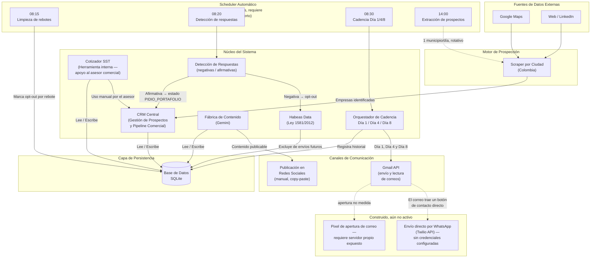
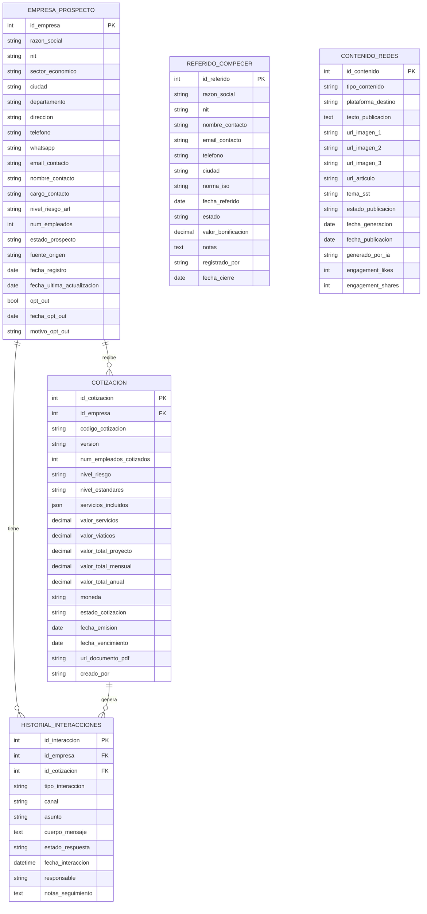
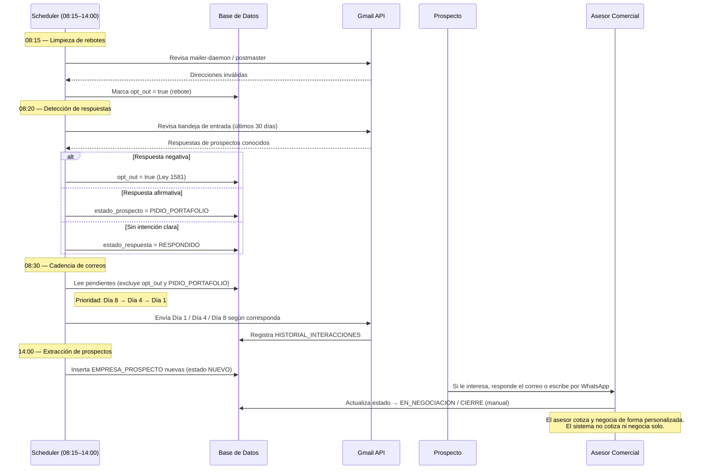

# Arquitectura y Diseño del Sistema
## Ecosistema Inteligente de Prospección Comercial, CRM y Automatización de Cotizaciones para Servicios SST

**Cliente:** Medina SST Empresarial SAS
**Versión:** 1.2.0
**Fecha:** 2026-08-20
**Clasificación:** Documentación Técnica Interna

---

## 1. Introducción

Medina SST Empresarial SAS es una empresa colombiana especializada en la prestación de servicios de Seguridad y Salud en el Trabajo (SST), con capacidad de atender empresas en múltiples ciudades del territorio nacional. El crecimiento del mercado regulado por la **Resolución 0312 de 2019** del Ministerio del Trabajo exige una operación comercial ágil, trazable y escalable.

El presente sistema constituye un **ecosistema de software integrado** diseñado para automatizar el ciclo completo de prospección, relacionamiento y cotización de clientes empresariales. Sus pilares funcionales son:

- **Motor de Prospección:** scraping automatizado de empresas objetivo en Google Maps y web/LinkedIn, segmentado por ciudad y sector económico en Colombia.
- **CRM Central:** gestión del ciclo de vida del prospecto desde el primer contacto hasta el cierre comercial.
- **Cotizador SST:** generación de propuestas económicas parametrizadas según los estándares de la Resolución 0312.
- **Cadencia de Outreach por Email:** secuencia automatizada Día 1 → Día 4 → Día 8, íntegramente por correo (con un botón de contacto directo por WhatsApp dentro del mensaje), con el objetivo de generar interés y que el prospecto contacte directamente a la empresa.
- **Automatización diaria (Scheduler):** de lunes a viernes, sin intervención manual, el sistema limpia rebotes, detecta respuestas de prospectos y dispara la cadencia de correos a la hora que corresponde.
- **Habeas Data automático:** las respuestas negativas de un prospecto activan su exclusión (opt-out) sin que nadie tenga que hacerlo a mano, cumpliendo la Ley 1581 de 2012.
- **Fábrica de Contenido:** generación diaria automatizada de artículos y copys para redes sociales.

---

## 2. Diagrama de Componentes

El siguiente diagrama representa la arquitectura de alto nivel del sistema, mostrando los módulos principales y sus dependencias de comunicación. El bloque **"Construido, aún no activo"** agrupa componentes que existen en el código pero no están en operación (faltan credenciales o infraestructura adicional).



---

## 3. Diagrama Entidad-Relación (DER)

El siguiente DER describe el modelo de datos relacional real (`src/database/models.py`). Se representan las cinco tablas con sus atributos, claves primarias (PK) y claves foráneas (FK).



> `REFERIDO_COMPECER` es una tabla independiente (no tiene llave foránea hacia `EMPRESA_PROSPECTO`) — los referidos a Compecer se registran aparte porque no siempre son empresas que ya estén en el CRM de Medina SST.

---

## 4. Flujo Diario End-to-End



---

## 5. Cadencia de Outreach por Email

La secuencia de contacto automatizado tiene 3 puntos de contacto, todos por correo (`src/modules/outreach/sequence_orchestrator.py`):

| Día | Plantilla | Contenido | Condición para dispararse |
|---|---|---|---|
| **1** | `PRIMER_CONTACTO` | Presentación de Medina SST + gancho generado por IA | Al registrar el prospecto (si tiene email y no está en opt-out) |
| **4** | `RECORDATORIO_VENCIMIENTO` | Recordatorio con nuevo ángulo — objeción de costo/tiempo | ≥3 días desde el Día 1, si aún no respondió |
| **8** | `ULTIMO_CONTACTO` | Cierre cordial, sin presión, puerta abierta | ≥4 días desde el Día 4 |

Los tres correos incluyen un botón verde de contacto directo por WhatsApp — es un enlace `wa.me` dentro del correo, no un envío automático por WhatsApp (ver sección 6, Twilio no está activo).

Si el prospecto responde en cualquier punto de la cadencia, la detección de respuestas (08:20) lo saca del flujo automáticamente: negativa → opt-out, afirmativa → `PIDIO_PORTAFOLIO`. En ambos casos el orquestador deja de enviarle más correos automáticos.

Toda la cadencia queda trazada en `HISTORIAL_INTERACCIONES` con `tipo_interaccion = "SECUENCIA_CADENCIA"` y `notas_seguimiento` con prefijo `[SEQ:DIA_1]`, `[SEQ:DIA_4]` o `[SEQ:DIA_8]`. Cada etapa se **reserva en la base de datos antes de enviar el correo**, apoyándose en un índice único, para que dos disparadores simultáneos (scheduler + botón manual del panel) no dupliquen el envío.

> **Importante:** La cadencia automatizada tiene como único objetivo despertar el interés del prospecto. Una vez que el prospecto contacta al asesor comercial, la negociación y presentación de la propuesta económica se realizan de forma **personalizada y manual** por parte del asesor. El Cotizador SST del sistema es una herramienta de apoyo interno para que el asesor prepare las cifras, no un proceso automático.

---

## 6. Stack Tecnológico Implementado

| Capa | Tecnología | Estado |
|---|---|---|
| Frontend / CRM | Python + **Streamlit** | Implementado |
| Visualización | Plotly + Pandas | Implementado |
| Base de datos | **SQLite** (local, `comercial.db`) | Implementado |
| ORM | SQLAlchemy 2.0 + Alembic | Implementado |
| Scraping | Playwright + BeautifulSoup + httpx | Implementado |
| IA — gancho de correos | **Gemini** (`gemini-2.5-flash`, Google — capa gratuita) | Implementado |
| IA — artículos y redes | **Gemini** (`gemini-flash-lite-latest`) | Implementado |
| IA — optimización de asuntos | **Claude** (`claude-haiku-4-5`, Anthropic) — solo en Analítica | Implementado |
| Generación de imágenes | Prompts automáticos (DALL-E 3 / Stable Diffusion — opcional) | Prompts listos, activación pendiente |
| Email (envío y lectura) | Gmail API (OAuth 2.0) | Implementado |
| Detección de rebotes | Escaneo Gmail (mailer-daemon/postmaster) | Implementado |
| Detección de respuestas | Escaneo Gmail (frases negativas/afirmativas) | Implementado |
| WhatsApp — envío automático | Twilio API | Código instalado, **sin credenciales — no activo** |
| WhatsApp — contacto directo | Enlace `wa.me` dentro de los correos | Implementado |
| Apertura de correos (open rate) | Pixel de tracking | Diseñado, **requiere servidor propio expuesto a internet — no activo** |
| Automatización diaria | Librería `schedule` (Python) | Implementado |
| Documentos | ReportLab + Pillow | Implementado |
| Plantillas HTML | Jinja2 | Implementado |
| Compliance | Habeas Data (Ley 1581/2012) — automático | Implementado |
| Configuración | python-dotenv (`.env`) | Implementado |

---

## 7. Estructura de Módulos del Proyecto

```
SOFTWARE COMERCIAL/
├── app.py                          # Punto de entrada Streamlit
├── start.bat                       # Inicia scheduler + panel
├── data/                           # Logs del scheduler, configuración (auto_dia1, etc.)
├── src/
│   ├── config.py                   # Configuración global (AppConfig singleton)
│   ├── data/
│   │   └── ciudades_colombia.py    # Referencia de ciudades + zonas de viáticos
│   ├── database/
│   │   ├── models.py               # Modelos ORM (5 entidades)
│   │   ├── connection.py           # Gestión de sesiones SQLAlchemy
│   │   └── init_db.py              # Creación de tablas + migraciones incrementales
│   ├── domain/
│   │   ├── entities.py             # Dataclasses puras + enums de negocio
│   │   └── resolution_0312.py      # Lógica Res. 0312/2019 (60 estándares)
│   ├── frontend/
│   │   ├── pages/                  # dashboard, cotizador, scraper, campanas,
│   │   │                           #   analitica, contenido, compecer
│   │   ├── components/             # Componentes reutilizables (métricas)
│   │   └── styles.py               # Estilos CSS personalizados
│   ├── modules/
│   │   ├── cotizador/              # Calculadora + viáticos + exportador PDF
│   │   ├── email/                  # Gmail client + plantillas + gancho IA + rate limiter
│   │   ├── whatsapp/               # Twilio client + plantillas (sin activar)
│   │   ├── outreach/                # Orquestador de cadencia Día 1/4/8
│   │   ├── scraper/                 # Engine + Google Maps + LinkedIn + pipeline
│   │   ├── contenido/                # Generador de artículos y copys (Gemini)
│   │   ├── tracking/                 # bounce_detector, reply_detector, pixel (inactivo)
│   │   └── compliance/               # Habeas Data (Ley 1581/2012)
│   └── scheduler/
│       └── auto_scheduler.py        # Tareas automáticas diarias (sección 4)
├── assets/                         # Logos (Medina SST, Compecer)
├── credentials/                    # Tokens OAuth Gmail (gitignored)
├── output/                         # Cotizaciones PDF + contenido generado
└── docs/
    └── arquitectura_y_diseno.md    # Este documento
```

---

*Documento actualizado el 2026-08-20 tras revisión contra el código real del repositorio. Para consultas contactar al equipo de desarrollo.*
